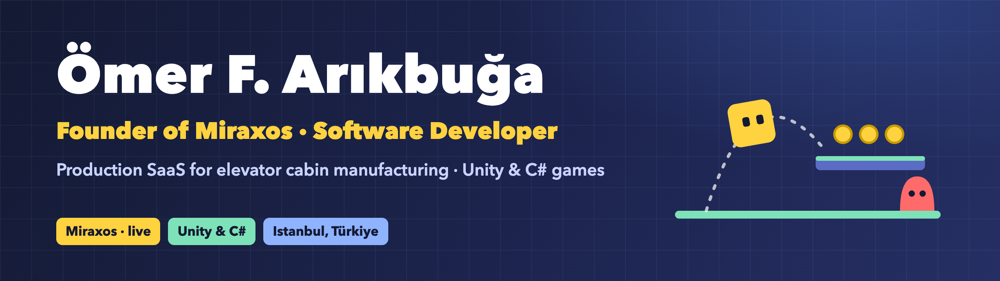

  

### 👋 Hi, I'm Ömer

I'm the founder of **[Miraxos](https://miraxos.com)**, a SaaS that turns elevator cabin dimensions into production-ready
CAD drawings and work orders, live and used by manufacturers in Türkiye. I also build games with **Unity & C#**.

---

### 🚀 Miraxos · Founder

Parametric CAD automation for elevator cabin manufacturing: engineers upload DXF part templates, customers enter their
dimensions, and Miraxos generates production-ready DXF drawings and work orders. Live at **[miraxos.com](https://miraxos.com)**.

---

### 🎮 Games

<table>
  <tr>
    <td width="50%" valign="top">
      
      
<b><a href="https://github.com/omerarkbua01/Unity-2D-Platformer">Unity 2D Platformer</a></b> 
      Coyote time, jump buffer, enemy AI state machine, checkpoints and moving platforms.
      Playable builds for Windows, macOS &amp; Android (v0.5).

    </td>
    <td width="50%" valign="top">
      
      
<b><a href="https://github.com/omerarkbua01/Unity-Snow-Surfer">Unity Snow Surfer</a></b> 
      Physics-based snowboarding: torque flips scored with <code>Mathf.DeltaAngle</code>,
      ScriptableObject power-ups, character select and a Cinemachine camera.

    </td>
  </tr>
</table>

---

### 🧰 Game Dev Toolkit

---

### 📫 Contact

